<p align="center">
  
</p>

<h1 align="center">CareTrail</h1>

<p align="center"><b>Your health history, understood, safe, and in the right doctor's hands only when you say so.</b></p>

<p align="center">
  <a href="https://caretrail-tan.vercel.app"><b>Live app: caretrail-tan.vercel.app</b></a>
  &nbsp;·&nbsp; Test account: <code>caretrail.test@example.com</code> / <code>CareTrail@2026</code>
</p>

Built in 24 hours at the IIITDM Kancheepuram web development hackathon, HealthTech track: *Lost in Transit: Fragmented Medical Records and Repeated Care Across Providers*.

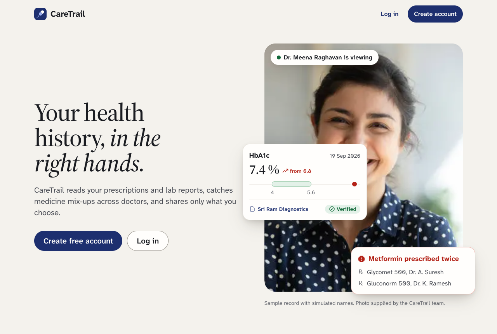

## Contents

1. [The problem](#the-problem)
2. [Our solution](#our-solution)
3. [Try it in two minutes](#try-it-in-two-minutes)
4. [Features](#features)
5. [How it works](#how-it-works)
6. [Security and privacy](#security-and-privacy)
7. [How the AI is kept honest](#how-the-ai-is-kept-honest)
8. [Accessibility and design](#accessibility-and-design)
9. [Setup instructions](#setup-instructions)
10. [Testing](#testing)
11. [Project structure](#project-structure)
12. [Known limits and next steps](#known-limits-and-next-steps)
13. [Disclosures](#disclosures)

## The problem

A patient with a long-term condition such as diabetes, high blood pressure or heart disease sees many doctors, labs and pharmacies. Each one keeps its own records, so the patient ends up carrying their history as paper prescriptions, lab PDFs and WhatsApp photos.

That causes real harm:

- **Doctors decide with half the picture.** A new doctor rarely sees what other doctors prescribed or what the last tests showed.
- **Medicines clash across doctors.** Two doctors can prescribe the same medicine under different brand names (a double dose), or two medicines that interact badly, and nobody notices.
- **Tests are repeated** because the last report is not at hand.
- **Sharing is all or nothing.** Patients forward whole folders on WhatsApp and can never take them back.
- **In an emergency** nobody knows the patient's blood group, allergies or medicines when they cannot speak.

## Our solution

CareTrail turns scattered papers into **one verified, source-linked health record that the patient controls**:

1. **Snap or upload** a prescription, lab report or discharge summary, or just type the doctor's notes. AI reads it; the patient checks it.
2. **One timeline and medicine list across every doctor**, with automatic safety checks: duplicate medicines, drug interactions and allergy clashes.
3. **Share safely:** a link that shows a doctor only what the patient chooses, ends on its own, and can be ended with one tap. The doctor sees a one-screen summary where **every fact opens the original document**.
4. **Emergency card:** a QR on the lock screen that shows the critical facts to paramedics without a login, and alerts the patient and their family.

Three surfaces, one design system: a warm, simple **patient app** (built for a 55-year-old on a phone), a dense one-screen **doctor view**, and a maximum-contrast **emergency page**.

## Try it in two minutes

1. Open **[caretrail-tan.vercel.app](https://caretrail-tan.vercel.app)** and log in with the test account:

   | Email | Password |
   |---|---|
   | `caretrail.test@example.com` | `CareTrail@2026` |

   It holds a simulated patient with 10 documents (typed and handwritten prescriptions, lab reports, a discharge summary), all read by the real AI pipeline. The account is shared by everyone testing, so you may see their changes too. Or create your own account (email, or *Continue with Google*).
2. **Home** shows medicine warnings, current medicines, tests still valid and the latest results.
3. **Add a record** with the sample files in this repo:
   - `demo-docs/overlap-test/p1.pdf` then `demo-docs/overlap-test/p2.jpg`: two doctors prescribing the same medicines under different brands. *Medicines* then shows three "prescribed twice" warnings and a red *Major interaction: Clopilet and Omez*.
   - `demo-docs/arun/lab_report.pdf`: a lipid profile; the values are saved with the lab's printed ranges.
   - `demo-docs/fresh/ravi-live-upload-rx-oct-2026.jpg`: a photo of a prescription for the check screen.
4. **Sharing:** create a link and open it in a private window (or scan the QR with your phone) to see the doctor's view.
5. **Emergency card:** create the QR on *Home → Your emergency card*, scan it with another phone.

## Features

### 1. Add records: photo, PDF, several pages, or typed notes

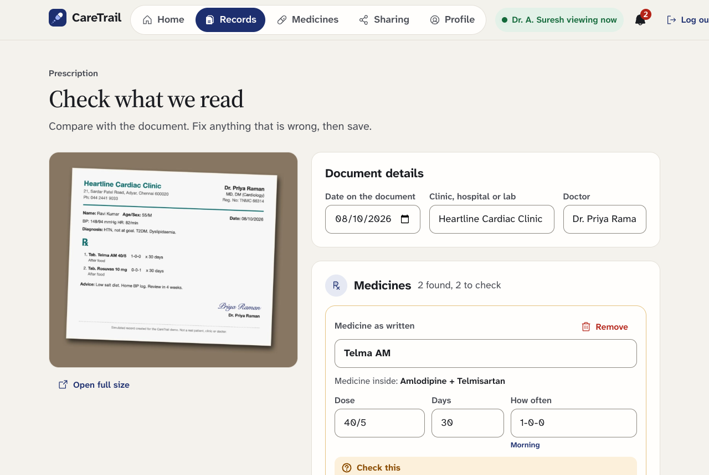

- **Upload a photo or PDF** (up to 10 MB). Phone photos are shrunk on the phone first, so uploads are fast on mobile data.
- **Several pages of one report** (several photos, or photos plus PDFs) are joined into one record, in order.
- **Consultation notes without a prescription:** choose *Consultation notes* and type what the doctor said; a photo is optional.
- **Duplicate detection:** the same file is recognised by its fingerprint and the patient is sent to the existing record.
- **AI reading in seconds** (Google Gemini). Lab reports that are read confidently are saved straight away. Prescriptions always go to **Check what we read**, beside the original document:
  - every medicine shows the exact words it came from ("On the document: …"),
  - brand names are matched to the medicine inside (*Glycomet* → metformin),
  - dosing shorthand is decoded (*1-0-1* → "morning and night", *0 0 1* or *001* → "night"),
  - the number of days is worked out from the written quantity (*= (20)* at *1-0-1* → 10 days) and the screen says how,
  - anything unclear is flagged *Check this*. Nothing joins the record until the patient saves it.
- If the AI service is busy, a second model takes over; if both fail, the file is kept and the patient can try again or type the details.

### 2. Home: what matters today

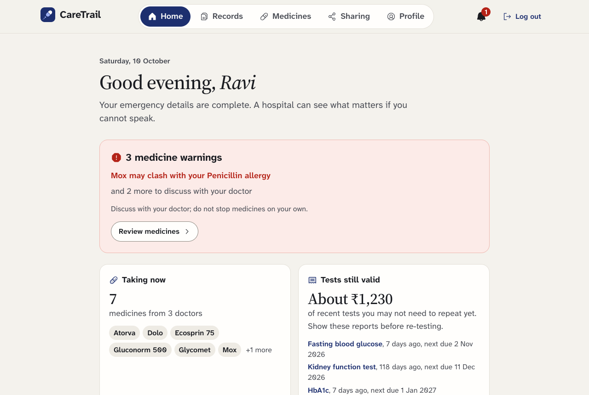

- **Medicine warnings** found across all doctors, serious ones first.
- **Taking now:** current medicines and how many doctors prescribed them.
- **Tests still valid (Test Saver):** recent tests that do not need repeating yet, their next due date and an estimated saving in rupees.
- **Latest results** drawn against the normal range printed on the lab's own report.
- **Alerts:** a bell in the header counts new alerts and opens a panel with all of them (emergency scans and access, doctors' notes, records waiting for a check, medicine warnings). Home shows at most two, each with a close button.

<p>
  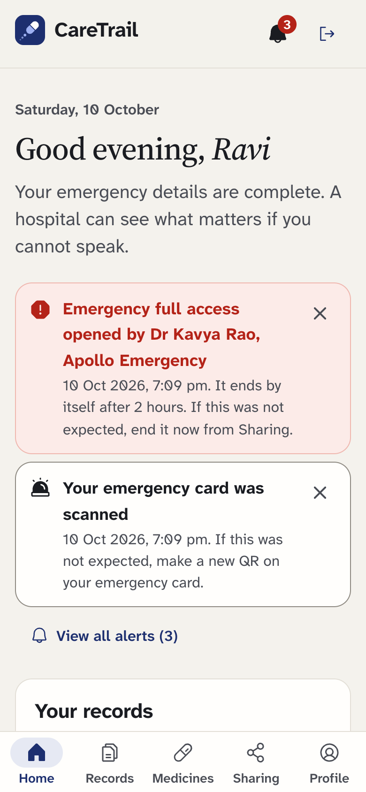
  &nbsp;
  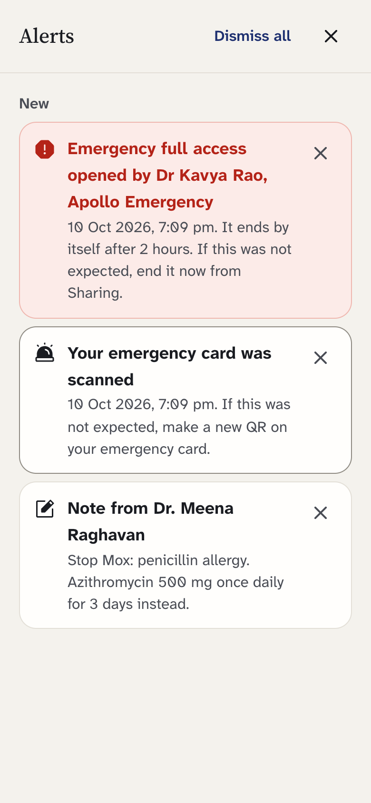
</p>

### 3. Timeline and trends

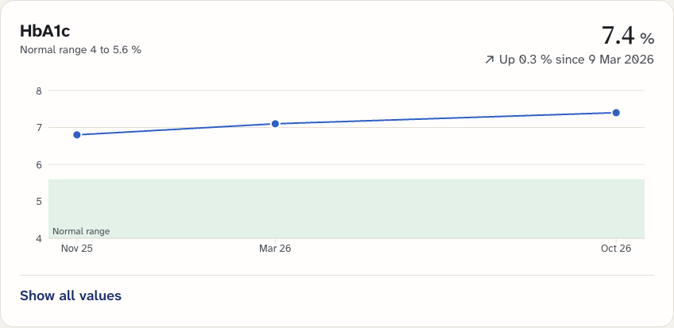

- Every document becomes one **timeline**, newest first, filterable by condition (diabetes, blood pressure, thyroid, asthma, heart), type and date.
- **Trends** for HbA1c, fasting sugar, blood pressure, TSH and LDL, against the normal band. Tap any point to open the report it came from.
- Every lab value keeps the **range printed on the report**; values outside it are marked.

### 4. Medicine safety across doctors

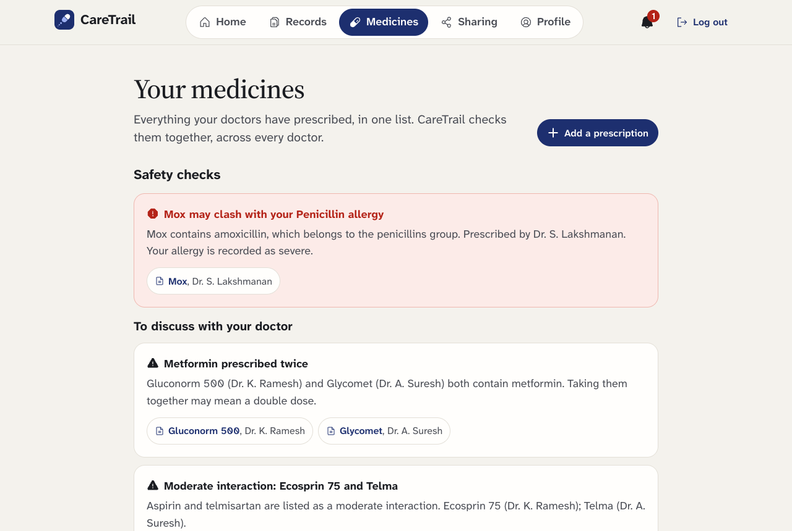

- **Duplicate therapy:** the same medicine under different brands from different doctors (e.g. Glycomet and Gluconorm are both metformin).
- **Drug interactions** from the DDInter database, by severity (major in red, moderate and minor folded).
- **Allergy clashes**, including by drug class (amoxicillin is a penicillin).
- Every warning names the medicines and the doctors who prescribed them, with links to the prescriptions.
- **Finished courses:** when the days written on a prescription have passed, the medicine leaves "Taking now" and the safety checks by itself. Medicines with no written length that are months old get a "Not taking it any more?" prompt.
- The patient can mark a medicine stopped or correct a dose; history is kept.

### 5. Sharing with a doctor, on the patient's terms

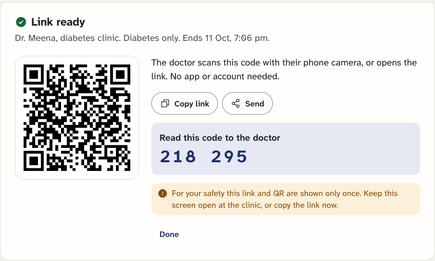

- The patient chooses **what** the doctor sees (some conditions, recent months, or everything) and **for how long** (1 hour, 24 hours, 7 days).
- Optional **6-digit code** read out in person, so a forwarded link is useless.
- The doctor **scans the QR or opens the link**: no app, no account; they enter their name (and registration number for *since your last view*).
- The patient sees **"Dr. … is viewing now"** live, and **End access** locks the doctor's screen within about 3 seconds.
- **Access history:** every open, document view, note, wrong code and blocked attempt, in a log nobody can edit or delete.

### 6. The doctor's view

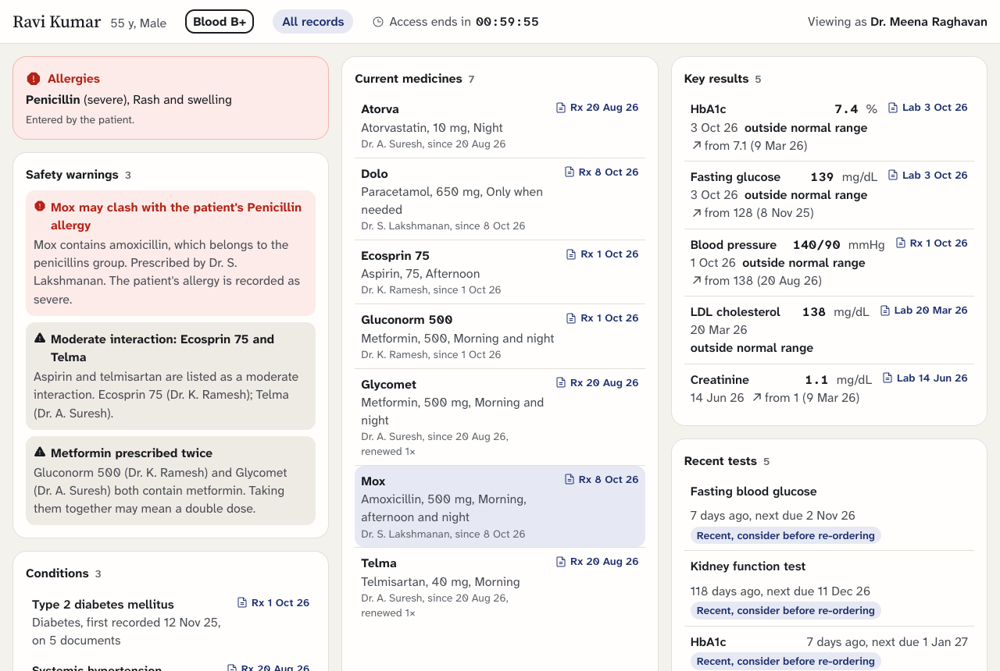

- One screen: allergies, safety warnings, conditions, current medicines, key results with their trend, recent tests ("consider before re-ordering"), hospital stays and documents.
- **Every fact opens its source:** the original document, with the exact words highlighted.

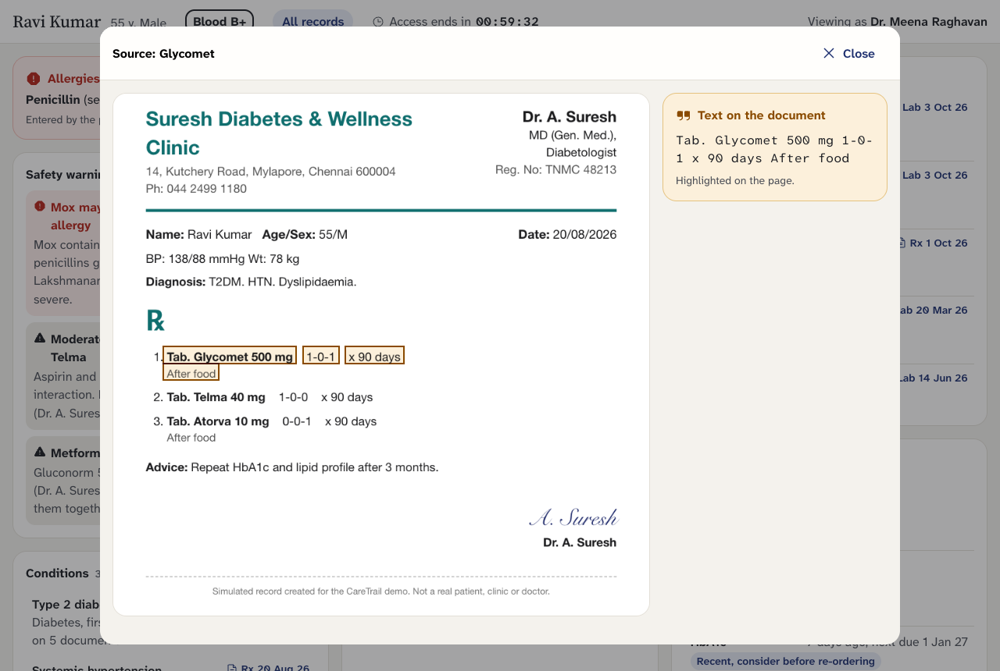

- **Since your last view:** a returning doctor (same name and registration number) sees only what changed since their last visit: new prescriptions, medicines started, changed or stopped, new results with the earlier value, new diagnoses and new warnings.

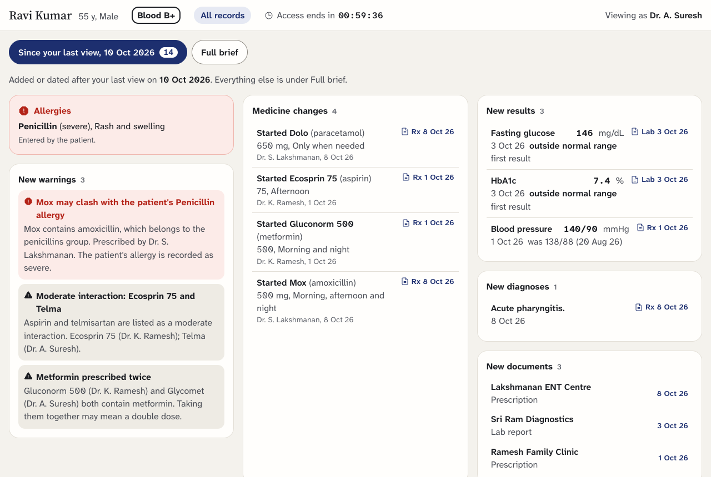

- **Doctor write-back:** if the patient allows it on that link, the doctor can leave a **note** or upload a **new prescription**. Notes appear on the patient's Home, Sharing page and alerts; prescriptions go through the same AI reading and wait for the patient's check, marked "Added by Dr. …".

### 7. Emergency card

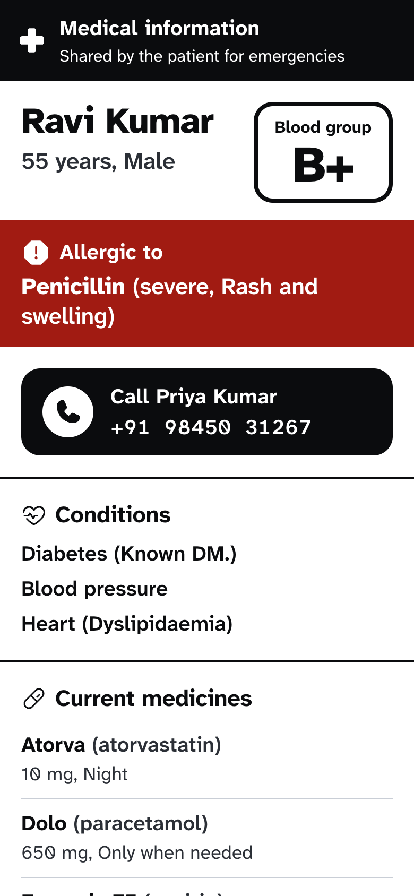

- The patient creates an **emergency QR** once and saves it as a **lock-screen image** or prints a **wallet card**.
- Anyone who scans it sees, **without logging in**, only the critical facts in large type: name, age, **blood group**, **allergies** (red band), current medicines, main conditions and a one-tap **Call** button for the emergency contact. No documents, lab history or doctors' names.
- Every scan is recorded; the patient sees it on Home and gets an **email**.
- **Emergency full access (break-glass):** a hospital doctor can open the full record for **2 hours** by entering their name, hospital and medical registration number. It is permanently logged, the patient and the emergency contact are **emailed at once**, and the patient can end it early.
- Lost the phone or wallet? **Make a new QR** and the old one stops working immediately.

### 8. And also

- **Sign in with email or Google.**
- **Profile:** blood group, allergies (with severity and reaction), emergency contact (name, phone, email).
- **Download my record (FHIR):** the whole record as a FHIR R4 file (Patient, Condition, MedicationStatement, Observation with LOINC codes where certain, AllergyIntolerance), each fact noting its source, for any hospital system.
- **Privacy policy** at [/privacy](https://caretrail-tan.vercel.app/privacy).
- Works on phones first (checked at 360 and 390 px), in light and dark mode.

### Every feature is tested

| Feature | Browser test |
|---|---|
| Sign up and log in (email or Google), profile, allergies, emergency contact | `phase-a` |
| Upload (photos, PDFs, several pages, duplicate block), AI extraction with confidence and source text, check screen beside the original, brands to generics, units, dosing shorthand, days from quantity | `phase-b`, `phase-m` |
| Consultation notes without a file; real handwritten prescriptions | `phase-n` |
| Timeline with filters, lab trends with normal ranges | `phase-c` |
| Safety checks across doctors, finished courses, Test Saver | `phase-d`, `phase-o` |
| Scoped, expiring share links (QR, optional code, revoke within seconds), access history and live viewer, source-linked doctor brief | `phase-ef` |
| Emergency QR, public card, lock-screen image, wallet card, scan alerts | `phase-g` |
| Emergency full access: logged 2-hour access, contact and patient emailed, revocable | `phase-i` |
| Since your last view | `phase-j` |
| Doctor write-back: notes and prescriptions, only where allowed | `phase-k` |
| FHIR R4 export | `phase-l` |
| Alert centre | `phase-p` |
| Test account shows every card with real uploads | `phase-h` |

## How it works

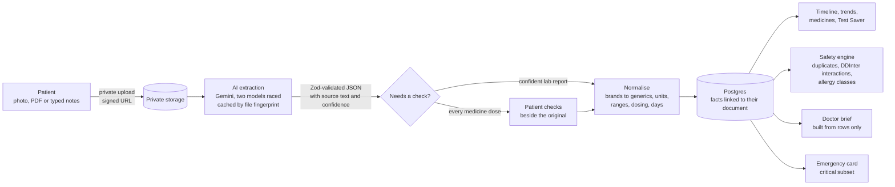

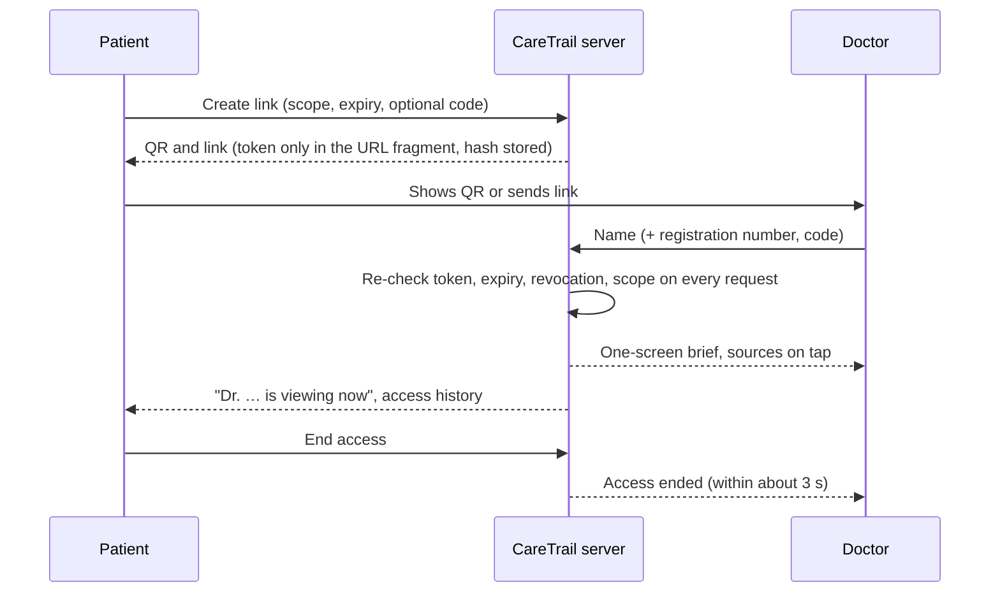

**Tech stack:** Next.js 16 (App Router) and React 19 in TypeScript (strict), Tailwind CSS 4, hosted on Vercel (Sydney region). Supabase Postgres with row-level security, Supabase Auth (email and Google) and private Storage, also in Sydney. Google Gemini for document reading, Brevo for alert emails, pdf.js for showing documents with highlights, Recharts for trends.

## Security and privacy

- **Row-level security on every patient table:** each account can only read its own records.
- **Doctors and emergency staff never read the database directly.** Every request goes through one server gate that re-checks the token, its expiry, revocation and scope each time. Out-of-scope documents are refused (403) and logged.
- **Share and emergency tokens** are 32 random bytes, carried only in the URL fragment (never sent to servers in the URL), and stored only as a SHA-256 hash. Unknown, expired and ended tokens all get the same "Access ended" answer, so tokens cannot be guessed by probing.
- **Files** sit in a private bucket and are shown only through links that expire after 5 minutes.
- **The access log is insert-only:** database triggers block edits and deletes, even with the service key. IP addresses are stored only as a salted hash.
- **Rate limits** on every token route (30 requests per minute per IP).
- **Secrets stay on the server**; the service key is only importable from server code.
- **Input and AI output are validated** with Zod before anything is stored.
- Emails are sent only for emergency events. The [privacy policy](https://caretrail-tan.vercel.app/privacy) explains what is stored and who processes it.

## How the AI is kept honest

- **It only copies what is written.** The prompt forbids guessing, correcting or adding medical knowledge; profile data is never sent to the model.
- **Every extracted item keeps its source text and a confidence score**, so it can be checked and highlighted on the original.
- **Every medicine dose goes to the patient's check screen** before it joins the record; low-confidence fields are flagged.
- **The model's JSON is validated** against a strict schema; anything else is rejected.
- **A file is never read twice:** results are cached by the file's fingerprint.
- **Speed and reliability:** the first model gets 12 seconds before a second model starts in parallel; the first valid answer wins.
- **Deterministic helpers** decode dosing patterns and work out days from quantities, from the written line itself.
- **The doctor's brief is built from database rows only.** No AI writes any part of what the doctor reads.

## Accessibility and design

- WCAG 2.1 AA: checked with axe-core on 19 screens, 0 violations.
- Touch targets of at least 44 px, body text of at least 16 px, labels above inputs, works at 200% zoom.
- Mobile first, checked at 360 and 390 px with no sideways scrolling; light and dark themes.
- Warnings always use an icon and words, never colour alone. Red is only for serious warnings, amber only for "needs checking", green only for verified.
- Type chosen for low-vision readers (Atkinson Hyperlegible). The emergency page keeps maximum contrast in every theme.

## Setup instructions

### What you need

- **Node.js 22** (`nvm use` reads `.nvmrc`) and npm.
- A **Supabase** project (free tier is enough).
- A **Google Gemini API key** ([aistudio.google.com](https://aistudio.google.com/apikey)).
- Optional: a **Brevo** account for alert emails; **Google OAuth** credentials for Google sign-in.
- Google Chrome, only for the browser tests.

### Steps

```bash
git clone https://github.com/itzRohit45/caretrail.git
cd caretrail
npm install
cp .env.example .env.local   # fill in the values (see below)
npm run migrate              # creates tables, security policies, storage bucket and reference data in Supabase
npm run gen-types            # regenerates TypeScript types from the database
npm run seed:test-account    # optional: the test account with 10 sample documents, read by the real pipeline
npm run dev                  # http://localhost:3000
```

### Environment variables (`.env.local`)

| Variable | Where it comes from |
|---|---|
| `NEXT_PUBLIC_SUPABASE_URL` | Supabase → Project Settings → API |
| `NEXT_PUBLIC_SUPABASE_PUBLISHABLE_KEY` | Supabase → Project Settings → API keys (publishable) |
| `SUPABASE_SECRET_KEY` | Supabase → Project Settings → API keys (secret). Server only. |
| `SUPABASE_DB_URL` | Supabase → Connect → connection string. Used only by `migrate` and `gen-types` on your machine; not needed on Vercel. |
| `GEMINI_API_KEY` | Google AI Studio |
| `GEMINI_MODELS` | Optional; default `gemini-3.5-flash-lite,gemini-3.6-flash` |
| `BREVO_API_KEY`, `ALERT_FROM_EMAIL` | Optional: Brevo API key and a verified sender address, for alert emails |
| `IP_HASH_SALT` | Any long random string |

### Google sign-in (optional)

1. Google Cloud Console → *Google Auth Platform*: set the app name, support email, home page (`https://<your-site>`) and privacy policy (`https://<your-site>/privacy`), add your Supabase domain to *Authorized domains*, and publish the app.
2. *Clients → Create client → Web application*, with the redirect URI `https://<project>.supabase.co/auth/v1/callback`.
3. Supabase → *Authentication → Sign In / Providers → Google*: paste the client ID and secret and enable it. In *URL Configuration*, set the site URL and add `https://<your-site>/auth/callback`.

The *Continue with Google* button appears by itself once the provider is on.

### Deploy to Vercel

Import the repository in Vercel, add the variables above (all except `SUPABASE_DB_URL`) to Production and Preview, and deploy. `vercel.json` pins the functions to Sydney (`syd1`) to sit next to the database.

## Testing

```bash
npm run typecheck && npm run lint && npm run build
npm test                                                   # 51 unit tests (normalisation, safety engine, Test Saver, scope, FHIR)
node --env-file=.env.local scripts/e2e/phase-b.mjs         # one browser suite (needs the dev server and Chrome)
E2E_BASE_URL=https://caretrail-tan.vercel.app node --env-file=.env.local scripts/e2e/phase-ef.mjs   # against the live site
```

- **15 browser suites** (`scripts/e2e/phase-a.mjs` to `phase-p.mjs`, about 200 checks) run the real flows end to end, including real AI reading of the sample documents. Each creates its own temporary account and removes it afterwards. All pass against the live site.
- `scripts/e2e/audit.mjs`: accessibility audit (axe-core, WCAG 2.1 AA) of every screen.
- `scripts/e2e/mobile-shots.mjs`: captures every screen at 360 and 390 px and fails on sideways scrolling.
- `scripts/e2e/readme-shots.mjs`: makes the screenshots in this README.

## Project structure

```
src/
  app/
    (auth)/            log in, sign up, Google sign-in
    (patient)/         home, records, upload, medicines, sharing, profile, emergency card
    s/                 the doctor's view (share links)
    e/                 the public emergency page
    privacy/           privacy policy
    auth/callback/     Google sign-in return
    api/               documents, extraction, timeline, trends, medicines, safety, shares,
                       share-link routes (s/*), emergency (e/*), alerts, FHIR export
  components/          UI by area: ui (design system), records, medicines, sharing,
                       doctor, emergency, alerts, patient, auth
  lib/
    extraction/        prompt, response schema, Gemini client, cached and raced runner
    normalise/         brands to generics, lab units and ranges, dosing patterns, dates
    safety/            duplicates, interactions, allergy classes, finished courses, Test Saver
    sharing/           tokens, scope, the single request gate, access log, rate limits
    brief/             the doctor's brief, built from database rows only
    records/           check screen, saving facts, timeline, trends
    export/            FHIR R4 bundle
supabase/migrations/   schema, row-level security, triggers, reference data (55 generics,
                       about 100 brands, 293 DDInter interaction pairs, test validity)
scripts/               migrations, type generation, test account, sample document builder, browser tests
demo-docs/             simulated prescriptions and lab reports (PDFs and phone-style photos)
```

## Known limits and next steps

**Known limits**
- Handwriting is read with varying success from one try to the next; every dose always goes to the patient's check, and dosing patterns are also read from the written line.
- Days are worked out from a quantity only when it divides exactly by the doses a day; bottles, creams and inhalers are never converted.
- Interaction checks cover the medicines in the DDInter dataset (55 curated generics).
- Doctors are identified by the name and registration number they type; these are not verified against the medical council register.
- Typed consultation notes are stored with a standard font, so letters outside the Latin alphabet are replaced.
- The test account is shared by everyone testing.

**Next steps**
- WhatsApp: forward a report to CareTrail's number and it joins the record; emergency alerts on WhatsApp.
- Verified doctor accounts through India's National Medical Register or the ABDM Healthcare Professionals Registry.
- Family profiles managed from one account; plain-language explanations of results, in Tamil too.

## Disclosures

Everything below was used to build CareTrail. All sample records in `demo-docs/` and the test account are simulated: fictional clinics, doctors and patients.

| Item | Use |
|---|---|
| Next.js 16, React 19, TypeScript | Web app framework and API routes |
| Tailwind CSS 4 (+ `@tailwindcss/turbopack`) | Styling with project design tokens |
| Supabase (Postgres, Auth, Storage) via `@supabase/supabase-js`, `@supabase/ssr` | Database with row-level security, login (email and Google), private file storage |
| Zod | Validation of all API input and AI output |
| Recharts | Lab trend charts |
| qrcode.react | Share and emergency QR codes |
| pdf.js (`pdfjs-dist`) | Showing documents and highlighting source text |
| pdf-lib | Joining several photos or PDFs of one report, and turning typed notes into a PDF, in the browser |
| Phosphor Icons (`@phosphor-icons/react`) | Icons |
| `server-only` | Keeps server secrets out of browser code |
| Google Gemini API (`gemini-3.5-flash-lite`, `gemini-3.6-flash`) | Reading documents. Free tier: Google may use submitted content to improve its services, which the privacy policy tells users before they upload. |
| Google sign-in (Google Auth Platform, through Supabase Auth) | Optional sign-in |
| Brevo transactional email API | Emergency scan and emergency access alert emails |
| Atkinson Hyperlegible Next / Mono (Braille Institute) and Source Serif 4 (Adobe), via Google Fonts | Body type for low-vision readers; serif for headings and numbers |
| Kalam (Google Fonts) | Handwriting style used only to generate the simulated prescriptions |
| Portrait photo supplied by the team (source and licence to be confirmed by the team before public use) | Landing page |
| DDInter drug-drug interaction dataset (Xiong et al., Nucleic Acids Research 2022, ddinter.scbdd.com) | Interaction pairs and severity, filtered to 55 curated generics (293 pairs); free for academic, non-commercial use |
| LOINC codes (Regenstrief Institute) | Standard codes for common lab tests in the FHIR export |
| Brand-to-generic map and test validity table | Hand-curated for this project from publicly known Indian brand names and typical lab practice; not a clinical database |
| Vercel | Hosting |
| `pg` (dev) | Migration runner and type generator |
| Vitest (dev) | Unit tests |
| tsx (dev) | Runs TypeScript scripts (seeding, extraction checks) |
| Playwright Core (dev, drives local Chrome) | Browser tests and screenshots |
| axe-core via `@axe-core/playwright` (dev) | Accessibility audit |
| ESLint (dev) | Linting |
| Agent skills used during development: ui-ux-pro-max, design-taste-frontend, impeccable, ponytail, graphify | Design research, UI audits, code-size discipline, code graph |
| Claude Code (Anthropic) | AI pair programmer used to write code |

CareTrail is an information tool, not medical advice.
